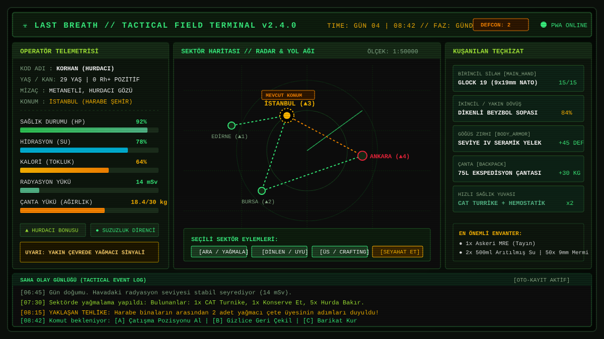
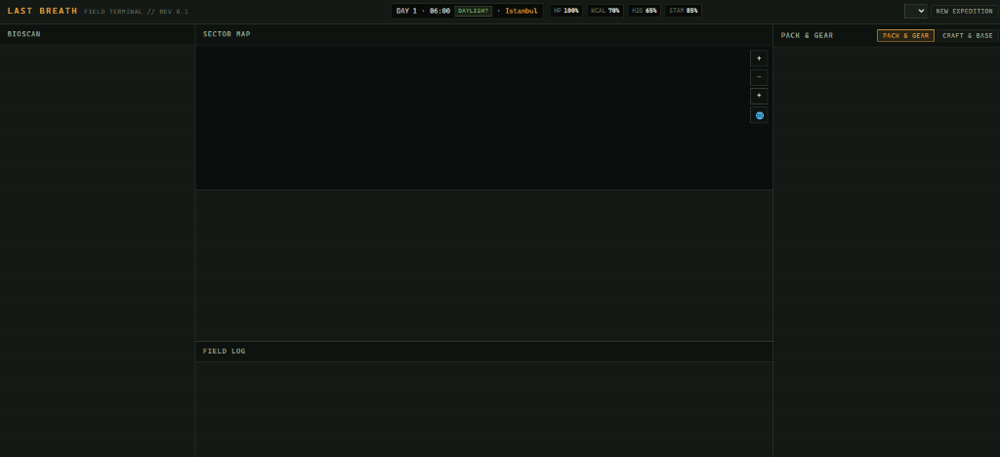

# ☣️ LAST BREATH // SON NEFES
### *Tactical Post-Apocalyptic Survival & Field Telemetry Simulation*

[](./manifest.webmanifest)
[](#)
[-blue?style=flat-square)](#)
[](#)
[](#)

<p align="center">
  
</p>

---

## 📌 Table of Contents
1. [About the Game & Lore](#-about-the-game--lore)
2. [Key Highlights](#-key-highlights)
3. [Screenshots & Visual Interface](#-screenshots--visual-interface)
4. [Gameplay Mechanics](#-gameplay-mechanics)
   - [Character Creation & Identity](#1-character-creation--identity)
   - [Map & Sector Exploration](#2-map--sector-exploration)
   - [530+ Authentic Item Catalog](#3-530-authentic-item-catalog)
   - [Interactive Looting (Loot Modal)](#4-interactive-looting-loot-modal)
   - [Turn-Based Tactical Combat](#5-turn-based-tactical-combat)
   - [Shelter Construction & Crafting](#6-shelter-construction--crafting)
5. [Multi-Slot Save System (10 Slots // 2 Free, 8 Premium)](#-multi-slot-save-system)
6. [Mobile Compatibility & PWA (Progressive Web App)](#-mobile-compatibility--pwa-support)
7. [Tech Stack & Architecture](#-tech-stack--architecture)
8. [Directory Structure](#-directory-structure)
9. [Installation & Setup](#-installation--setup)
10. [Contributing & License](#-contributing--license)

---

## 📻 About the Game & Lore

**Last Breath (Son Nefes)** is a tactical survival RPG simulation built on real-world geography, set across the desolate Eurasian and Mediterranean basins following a combined nuclear and biological collapse.

The player navigates through ruined metropolises, irradiated marshes, abandoned military outposts, and sectors overrun by roving scavenger gangs. To survive, you must balance critical telemetry indicators—such as hunger, thirst, exhaustion, core body temperature, and radiation—while scavenging and crafting from a catalog of over 530 authentic items and fortifying your own shelter.

---

## 🌟 Key Highlights

- **Retro-Terminal Military UI:** An atmospheric user interface rendered in amber, olive drab, and rust tones, complete with authentic CRT scanline overlays and dynamic signal telemetry.
- **Zero Runtime Dependencies:** Developed strictly using modern vanilla JavaScript (ES Modules) and pure CSS3—free from frameworks like React or Vue, and without third-party runtime libraries.
- **Tactical Combat 2.0:** Deep turn-based engagements featuring 5 range bands (melee to extreme distance), light and heavy physical cover, targeted anatomical zones (cranial crits, leg fractures, disarming strikes), firearm mechanical feed jamming, and dynamic enemy morale/surrender decisions (spare & disarm vs. execute).
- **True Barter Economy:** Zero fiat currency; direct commodity exchange of ammunition, medical compounds, clean water, and salvage with Nomad Guild, Iron Guard, and Wasteland merchants; real-time trade balance calculations, faction reputation discounts, and skill-based haggling negotiations.
- **Dynamic Weather & Thermal Simulation:** Acid rain, radioactive ash fog, sub-zero cold fronts, and gale windstorms directly affect core body temperature (hypothermia), cause shivering-induced calorie depletion, deliver chemical burns, and alter tactical visibility (tactical flashlights increase ambush hazard by 300%).
- **Targeted Anatomical Trauma Schema:** Discrete tracking of 6 body parts for fractures, arterial bleeding, tension pneumothorax, and infection risk; resolved through clinical field treatments including CAT tourniquets, chest seals, SAM splints, and ciprofloxacin.
- **Faction Diplomacy & Dynamic Encounters:** Dynamic standing ratings ranging from -100 to +100 across the Iron Guard, Nomad Guild, and Ash Marauders, affecting barter rates, tolls, and engagement rules.
- **530+ Authentic Items:** Extensive catalog ranging from specialized surgical tools and broad-spectrum antibiotics to 12-gauge shotguns and Level IV ceramic strike plates.
- **Interactive Looting Modal:** Dedicated scavenging dialog allowing selective item looting governed by real-time weight limits to prevent encumbrance.
- **Multi-Slot Save Architecture (10 Slots):** 2 standard open slots and 8 extended Survivor Premium save slots.
- **Progressive Web App (PWA):** Native "Add to Home Screen" support on Android, iOS, and desktop platforms; full offline execution via Service Worker caching.
- **Instant Dual-Language Localization (TR / EN):** Seamless runtime language switching between Turkish and English across all UI elements, logs, items, and mechanics without page reloads.

---

## 📸 Screenshots & Visual Interface

The game channels the monochromatic green and amber CRT visual aesthetic of post-apocalyptic field computer terminals into modern mobile and desktop browsers.

| 🖥️ Desktop Tactical Terminal & Radar Map | 📱 Mobile-Optimized Field Telemetry & HUD |
| :---: | :---: |
|  |  |
| *Desktop: Vector sector network, radar, bio-telemetry, and action log* | *Mobile: Compact telemetry, overflow-free vitals, and PWA installation* |

> 💡 **CRT & Terminal Experience:** Designed with simulated phosphor glow, scanlines, and retro typography. For optimal immersion, run your desktop browser in full-screen mode (`F11`) or install the game as a PWA on your mobile home screen.

---

## 🎮 Gameplay Mechanics

### 1. Character Creation & Identity
Every expedition begins with an in-depth, 4-phase deployment setup:
- **Identity:** Manual name entry or randomized apocalyptic callsign generator.
- **Age Dynamics:** Scaled between 18 and 65 years old.
  - *Young (18–25):* Peak physical condition, accelerated stamina regeneration.
  - *Mature (26–40):* Balanced fortitude, physical strength, and agility.
  - *Veteran (41–65):* Seasoned field survival experience; enhanced scavenging yield and crafting efficiency.
- **Blood Type:** Complete compatibility matrix (A+, A-, B+, B-, AB+, AB-, O+, O-) affecting clinical field transfusions.
- **Traits:** *Stoic*, *Scavenger*, *Medic*, *Athlete*, *Insomniac*, *Packmule*.
- **Background Archetypes:**
  - **Scavenger:** Deploys with a pry bar, rucksack, and fundamental tool kit.
  - **Soldier (Military Deserter):** Deploys with a service sidearm, ammunition reserve, and tactical load-bearing vest.
  - **Field Medic:** Deploys with a trauma kit, surgical scalpel, and broad-spectrum antibiotics.
  - **Civilian Survivor:** Deploys with a rugged utility jacket, hunting knife, and basic rations.
- **Deployment Sector:** Istanbul (Urban Ruins), Ankara (Steppe Bunker), Izmir (Abandoned Harbor), etc.

### 2. Map & Sector Exploration
- World navigation relies on an interactive vector SVG engine supporting smooth pan, zoom, center-lock, and inter-sector route plotting.
- Every sector contains distinct biome profiles (Urban Ruins, Wasteland, Forest, Mountainous Terrain, Coastal Zone) and danger threat ratings (`▲ 1` through `▲ 5`).
- Inter-sector transit expends in-game time, water, and calories, while nocturnal movement sharply elevates hostile ambush probabilities.

### 3. 530+ Authentic Item Catalog
All game items are defined in [`src/data/items.js`](./src/data/items.js), fully cataloged with bilingual titles and lore descriptions:
- **Rations & Hydration (`supplies` - 132 items):** Military MREs, beef jerky, purified water, energy bars, field tea/coffee, multivitamins, shelf-stable canned goods.
- **Medical Supplies (`medical` - 95 items):** CAT tourniquets, Z-folded hemostatic combat gauze, vented chest seals, decompression needles, SAM malleable splints, ciprofloxacin, fentanyl transdermal patches, atropine auto-injectors, Ringer's lactate IV bags.
- **Weapons & Ballistics (`weapons` - 117 items):**
  - *Blunt/Bladed:* Barbed-wire baseball bat, tactical tomahawk, Gurkha kukri, trench knife.
  - *Firearms:* Glock 19, Colt 1911 .45 ACP, Remington 870 shotgun, sawn-off double-barrel, SKS carbine, Mosin-Nagant, AR-15, FN FAL, MP5.
  - *Ammunition Crates:* 9mm, .45 ACP, 12G 00 buckshot, .22 LR, 5.56 NATO, 7.62x39 Soviet, .308 Win.
  - *Explosives:* Improvised nail-pipe bombs, thermite incendiary grenades, smoke canisters, Claymore mines.
- **Scrap & Engineering Components (`scrap` - 97 items):** Copper piping, galvanized sheet metal, 12V lead-acid batteries, 18650 lithium cells, MPPT solar controllers, lead-free solder wire, RTV silicone sealant, motor oil, calcium carbide, neoprene rubber.
- **Gear & Survival Utilities (`gear` - 90 items):** Level IV ceramic body armor, Nomex firefighting coats, Vibram-soled combat boots, 75L expedition rucksacks, folding titanium wood stoves, 2000-lumen torches, hand-crank emergency radios.

### 4. Interactive Looting (Loot Modal)
Scavenging runs do not deposit items straight into your bag:
- Successful searches launch a tactical **Looting Dialog**.
- Players manually toggle the items they intend to take.
- Selected mass is checked dynamically against available carry capacity to avoid overload penalties.

### 5. Turn-Based Tactical Combat
- Traversing sectors or scavenging ruins may trigger hostile encounters with raiders, infected stragglers, or predatory wildlife.
- Weapon damage profiles, effective range advantages, ballistic armor classes, and remaining ammo pools determine hit probabilities.
- Mid-skirmish emergency actions include packing open wounds with hemostatics or administering field analgesics.

### 6. Shelter Construction & Crafting
- Salvaged scrap, electronics, and chemicals allow players to upgrade their base Workbench tiers.
- Players can construct critical base infrastructure, including rainwater harvesting barrels, medical distillation retorts, sleeping quarters, and fuel-powered generators.

---

## 💾 Multi-Slot Save System

The engine provides robust multi-session management without overwriting progress:
- **10 Save Slots:**
  - **Slots 1 & 2 (Free):** Fully unlocked, functional save slots available to all players.
  - **Slots 3 through 10 (Survivor Premium):** Extended expedition slots intended for alternate playstyles and multiple survival runs.
- **Slot Metadata:** Displays survivor callsign, archetype, active sector, survival day, in-game timestamp, physical condition, and local save time.
- **Testing & Debug Modes:** Toggle options directly from the settings or slot interface using **"ENABLE PREMIUM (FREE TRIAL)"** or **"TEST LOCKED MODE"**.

---

## 📱 Mobile Compatibility & PWA Support

Last Breath scales seamlessly from wide-screen desktop displays down to compact smartphone viewports:

### 1. Mobile HUD Optimization
- **Smartphone Screens:** The header bar wraps into fluid tiers; project branding and system buttons remain pinned above, while player telemetry (Name, Day, Hour, Phase, Sector) expands to 100% width to prevent text clipping.
- **Vitals Telemetry:** Vitals are positioned in a 4-column balanced grid along the bottom viewport edge.

### 2. PWA (Progressive Web App) Setup
- **Android / Chrome / Edge:** An **`📲 INSTALL`** action appears in the top navigation bar for single-tap device installation.
- **iOS Safari:** Integrated modal guide for Apple devices (Safari Share Menu → "Add to Home Screen").
- **Full Screen & Offline Capability:** Once added, browser chrome and address bars are hidden, executing as a standalone application backed by offline caching.

---

## 🛠 Tech Stack & Architecture

| Layer | Technology / Implementation |
| :--- | :--- |
| **Core Engine** | Vanilla Modern JavaScript (ES2022+ Modules) |
| **UI Styling** | Pure CSS3 (CSS Variables, Flexbox, CSS Grid, Custom Theme Engine) |
| **State Management** | EventBus & Unidirectional Reactive Store ([`src/core/store.js`](./src/core/store.js)) |
| **Audio Synthesizer** | Zero-Asset Procedural Web Audio API Sound Engine ([`src/core/audioEngine.js`](./src/core/audioEngine.js)) |
| **Map Rendering** | Interactive SVG Matrix Transformations & Viewport Culling |
| **Save Subsystem** | Multi-slot manager built on the browser LocalStorage API ([`src/core/saveManager.js`](./src/core/saveManager.js)) |
| **PWA & Caching** | Service Worker Cache-First / Stale-While-Revalidate ([`sw.js`](./sw.js)) |
| **Build Tooling** | Custom zero-dependency Node bundler script ([`build.mjs`](./build.mjs)) |
| **Development Server** | Native Node.js HTTP server ([`server.mjs`](./server.mjs)) |

---

## 📂 Directory Structure

```
Last Breath/
├── css/
│   ├── components/
│   │   ├── map.css              # Map viewport and stage styling
│   │   └── panels.css           # Inventory, menu, modal, slot, and PWA styling
│   ├── layout.css               # Header HUD, layouts, and responsive media queries
│   └── main.css                 # Color palettes, typography, and CRT filters
├── dist/
│   └── app.bundle.js            # Compiled single-file application bundle
├── docs/
│   └── images/                  # Terminal interface previews and mobile screenshots
├── icons/
│   ├── apple-touch-icon.png     # iOS home screen icon (180x180)
│   ├── icon-192.png             # Android standard PWA icon (192x192)
│   ├── icon-512.png             # Android high-res icon (512x512)
│   └── icon.svg                 # Vector badge icon
├── locales/
│   ├── en.json                  # English localization (Menus, telemetry, 530+ items)
│   └── tr.json                  # Turkish localization (Menus, telemetry, 530+ items)
├── src/
│   ├── core/                    # Event bus, RNG, timekeeper, save managers, engine core
│   │   ├── audioEngine.js       # Procedural Web Audio engine (Clicks, Geiger, Pulse, Firearm)
│   │   ├── clock.js
│   │   ├── coreModule.js
│   │   ├── effects.js
│   │   ├── engine.js
│   │   ├── eventBus.js
│   │   ├── rng.js
│   │   ├── saveManager.js       # 10-slot multi-save & Premium tier mechanics
│   │   └── store.js
│   ├── data/                    # Core static data structures
│   │   ├── archetypes.js        # Starting classes and initial loadouts
│   │   ├── balance.js           # Travel and calorie/hydration balance values
│   │   ├── encounters.js        # Random encounters and field triage encounters
│   │   ├── items.js             # 530+ authentic item definitions
│   │   ├── narratives.js        # Boot telemetries, field logs, radio broadcasts, and endings
│   │   ├── recipes.js           # Crafting recipes
│   │   ├── structures.js        # Base construction blueprints
│   │   └── traits.js            # Traits, blood types, and character name pools
│   ├── i18n/                    # Localization orchestration
│   │   ├── i18n.js
│   │   └── locales.js
│   ├── modules/                 # Game logic modules (Inventory, Map, Combat, Status, Base)
│   │   ├── base/
│   │   ├── combat/              # Tactical Combat 2.0 (Range bands, cover, targeted shots, jam, morale)
│   │   ├── crafting/
│   │   ├── economy/             # True Barter Economy (Commodity evaluation, merchant stock, haggling)
│   │   ├── environment/         # Dynamic weather, thermal exposure, acid/ash simulation (weatherEngine.js)
│   │   ├── factions/            # Faction diplomacy, karma, and encounter filtering
│   │   ├── inventory/
│   │   ├── map/
│   │   ├── skills/
│   │   └── status/              # Biometrics and anatomical trauma handling (bodyStatus.js)
│   ├── ui/                      # DOM view components
│   │   ├── barterModalView.js   # Interactive two-column barter trading table
│   │   ├── craftBaseView.js
│   │   ├── dom.js
│   │   ├── inventoryView.js
│   │   ├── logView.js
│   │   ├── lootModalView.js     # Tactical item scavenging dialog
│   │   ├── mapView.js
│   │   ├── menuView.js          # Main menu, character creation, slots, settings
│   │   └── statusView.js
│   ├── main.js                  # Engine entrypoint & bootstrap
│   └── pwa.js                   # PWA registration and install workflow
├── build.mjs                    # Native Node bundle script
├── index.html                   # HTML entrypoint
├── manifest.webmanifest         # PWA web manifest configuration
├── server.mjs                   # Native development HTTP server
├── sw.js                        # Offline caching Service Worker
└── world.svg                    # Vector sector world map
```

---

## 🚀 Installation & Setup

Running the project requires zero package manager dependencies (no `npm install` needed). The only prerequisite is an installed environment of **Node.js (v18 or higher)**.

### 1. Clone or Open the Repository
```bash
git clone https://github.com/username/last-breath.git
cd last-breath
```
*(Or switch directly into your local project directory)*

### 2. Build the Application Bundle
To apply any updates made to JavaScript or CSS source files into the runtime bundle:
```bash
node build.mjs
```
*Expected Output:* `Built dist\app.bundle.js (59 modules).`

### 3. Launch the Local Development Server
```bash
node server.mjs
```
*Expected Output:* `Last Breath server listening on http://localhost:4173`

### 4. Open the Game
Navigate to the following address in your web browser:
```
http://localhost:4173
```

---

## 📱 Mobile Testing & Installation

1. Ensure your host computer and mobile device share the same local Wi-Fi network. Check your host computer's local IPv4 address (e.g., `192.168.1.35`).
2. Open your mobile browser (Chrome or Safari) and navigate to `http://192.168.1.35:4173`.
3. **On Android:** Tap the **`📲 INSTALL`** button in the top HUD or choose *"Install App"* from your browser's menu.
4. **On iOS:** Tap the **Share** button in Safari's lower toolbar and select **"Add to Home Screen"**.
5. Launch the game directly from your device home screen as an offline-capable, standalone fullscreen application.

---

## 📜 Contributing & License

This project is licensed as open source under the terms of the [MIT License](./LICENSE). For full terms and copyright details, refer to the `LICENSE` file.

*Last Updated: November 2026 // Last Breath Field Terminal Rev 0.2*